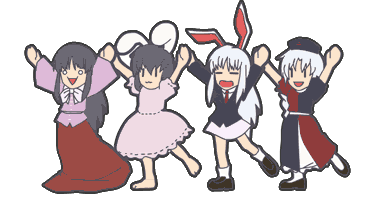

<!-- ═══════════════ HEADER ═══════════════ -->

  

  

  
  
  

<!-- ═══════════════ STACK ═══════════════ -->
<h2 align="center">tech stack</h2>

  

<!-- ═══════════════ STATS ═══════════════ -->
<h2 align="center">github stats</h2>

  

  
  &nbsp;
  
  &nbsp;
  

  

  

<!-- ═══════════════ SNAKE ═══════════════ -->

  

<!-- ═══════════════ FOOTER ═══════════════ -->

  

